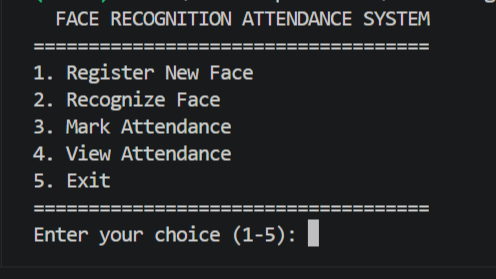

# Face Recognition Attendance System

A Python-based Face Recognition Attendance System that uses computer vision to detect and recognize registered faces and automatically record attendance with date and time.

## 🚀 Features

1. Face Detection using Haar Cascade Classifier.
2. Face Registration using a webcam.
3. Face Recognition using the LBPH algorithm.
4. Automatic Attendance Recording with date and time.
5. Prevents duplicate attendance on the same day.
6. View Attendance Records.
7. User-friendly menu for easy navigation.

## 🛠️ Technologies Used

- Python
- OpenCV
- OpenCV Contrib
- NumPy
- CSV
- Visual Studio Code

## 📁 Project Structure

```text
Face-Recognition-Attendance-System/
│
├── dataset/
├── main.py
├── register_face.py
├── recognize_face.py
├── attendance.py
├── view_attendance.py
├── menu.py
├── .gitignore
└── README.md
```

## ⚙️ Installation and Setup

### 1. Clone the Repository

```bash
git clone https://github.com/santoshpradhan90061/Face-Recognition-Attendance-System.git
```

### 2. Open the Project Folder

```bash
cd Face-Recognition-Attendance-System
```

### 3. Create a Virtual Environment

```bash
python -m venv .venv
```

### 4. Activate the Virtual Environment (Windows)

```bash
.venv\Scripts\activate
```

### 5. Install Required Libraries

```bash
pip install opencv-contrib-python==4.13.0.92 numpy
```

## ▶️ How to Run

Start the application using:

```bash
python menu.py
```

## 📋 Application Menu

1. Register New Face
2. Recognize Face
3. Mark Attendance
4. View Attendance
5. Exit

## 📸 Screenshots

## 📸 Screenshots



## 👨‍💻 Author

**Santosh Pradhan**

- GitHub: https://github.com/santoshpradhan90061
- Portfolio: https://santoshpradhan90061.github.io/santosh-portfolio/

## 🔒 Privacy and Disclaimer

This project is developed for educational purposes. Face registration and recognition should only be performed with participants' consent. Recognition results may not always be accurate, so attendance records should be verified before official use.

## 📄 License

This project is created for learning and educational purposes.